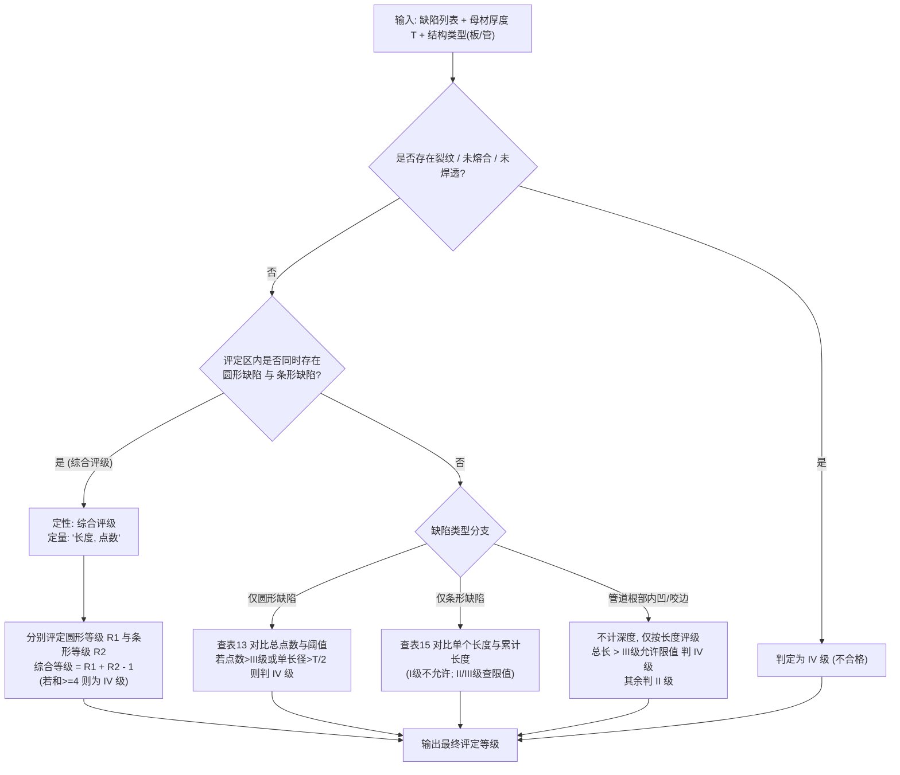

# 2026年全国无损检测射线 AI 大赛适配方案与待办工作清单

> 对应比赛：《2026 年全国无损检测射线 AI 智能评片技能大赛》
> 相关文档：[`竞赛规则.pdf`](../竞赛规则.pdf)、[`质量等级评定解读.pptx`](../质量等级评定解读.pptx)、[`pyqt-desktop-inference-plan.md`](pyqt-desktop-inference-plan.md)
> 进展与待办：[`competition-progress.md`](competition-progress.md)
> 基础物理参数：像素尺寸 $p = 0.042\text{ mm/pixel}$，图像格式 16 位 DCM。

---

## 1. 竞赛赛项与核心规则梳理

| 赛项 | 规模与时限 | 核心任务与输入 | 提交结果（得分项） | 关键规则/难点 |
| :--- | :--- | :--- | :--- | :--- |
| **一、人机大战** | 30 幅 DCM 40 分钟 | 压缩包《人机大战》+ Excel《影像信息表》 | 1. 焊缝型式（双面/单面） 2. 焊接方法（手工/埋弧/氩弧等选一） 3. 焊接位置（平/立/横/仰/全位置） 4. 缺陷定位、定性、定量、评定等级 | 提交后不可修改；需包含工艺属性推断；90分评定分+10分时间分 |
| **二、影像查重** | 1000 幅 DCM 30 分钟 | 压缩包《影像查重 1000 幅影像》（10~30GB） | 重复影像编号分组，如： `5,89,100,365` `258,658,965,859` | 30 分钟内完成 1000 幅（单幅 $\le 1.8$ 秒）；漏查扣分，错查/多查整组 0 分；超时 0 分 |
| **三、缺陷识别** | 600 幅 DCM 40 分钟 | 压缩包《缺陷识别》+ Excel《影像信息表》（规格/材质） | 1. 缺陷定位（最左侧 X 坐标） 2. 缺陷定性（含综合评级） 3. 缺陷定量（点数/长度/长度+点数） 4. NB/T 47013.2-2015 评定等级 | 40 分钟内完成 600 幅（单幅 $\le 4$ 秒）；禁止人工复核；全自动端到端处理；剩余时间计时间分（最高 10 分） |

---

## 2. 评定标准与数学换算规则（NB/T 47013.2-2015）

### 2.1 缺陷定位（最左侧 X 坐标）
1. **坐标系基准**：以**原始图像左上角为原点 $(0,0)$**，向右为 $X$ 正方向，向下为 $Y$ 正方向。
2. **反变换映射**：由于推理过程中执行了旋转矫正（`WeldOrientationCorrector`），输出的 bbox 位于矫正坐标系中，必须通过逆仿射矩阵还原至原始底片坐标系。
3. **最左侧边缘提取**：
   - 单个缺陷：$X_{\text{submit}} = \min(x)$（即目标框最左边界像素位置）。
   - 横向密集裂纹：聚类为一个缺陷，取该群中最左边缘的 $X$。
   - 断续未熔合/未焊透：间隔明显时分别记录，延展连续时按一个缺陷取最左边缘 $X$。
   - 条形缺陷/条渣组：同一直线方向评定区内间距满足合并条件时，作为一个缺陷，取最左边缘 $X$。
   - 圆形缺陷密集区：仅选择最严重评定区，以评定框内最左侧缺陷边缘确定 $X$。

### 2.2 缺陷定量（点数、毫米长度、“长度，点数”）
* **物理常数**：像素尺寸 $p = 0.042\text{ mm/pixel}$。

#### (1) 圆形缺陷：填写「实际点数」
- **长径计算**：$d = \max(\text{width}_{\text{pixel}}, \text{height}_{\text{pixel}}) \times 0.042\text{ mm}$。
- **不计点数过滤（表 14）**：
  - $T \le 25\text{ mm}$：$d \le 0.5\text{ mm}$（约 $\le 12$ 像素）不计点数；
  - $25 < T \le 50\text{ mm}$：$d \le 0.7\text{ mm}$（约 $\le 17$ 像素）不计点数；
  - $T > 50\text{ mm}$：$d \le 1.4\% \times T$ 不计点数。
- **点数折算（表 12）**：
  - $d \le 1.0\text{ mm} \implies 1\text{ 点}$
  - $1.0 < d \le 2.0\text{ mm} \implies 2\text{ 点}$
  - $2.0 < d \le 3.0\text{ mm} \implies 3\text{ 点}$
  - $3.0 < d \le 4.0\text{ mm} \implies 6\text{ 点}$
  - $4.0 < d \le 6.0\text{ mm} \implies 10\text{ 点}$
  - $6.0 < d \le 8.0\text{ mm} \implies 15\text{ 点}$
  - $d > 8.0\text{ mm} \implies 25\text{ 点}$
- **总点数**：在选定评定区内将所有计点缺陷的点数求和，输出纯整数（如 `8`）。

#### (2) 其他缺陷（条形/裂纹/未焊透/未熔合/咬边/内凹）：填写「实际长度值」
- 长度计算：$L = L_{\text{pixel}} \times 0.042\text{ mm}$，按规则保留 1 位小数或四舍五入。
- 复杂裂纹取直线长度；横向密集裂纹取最长单条长度；一组条形缺陷按共线间距准则累计。

#### (3) 综合评级：填写「长度，点数」
- 当圆形缺陷评定区内同时存在条形缺陷需综合评级时，定量栏输出格式固定为：`"{条形累计长度}, {圆形总点数}"`（如 `"14, 6"`）。

### 2.3 评定等级判定（I级 / II级 / III级 / IV级）

---

## 3. 具体待开发工作清单（Task Breakdown）

### 模块一：Excel《影像信息表》解析器（`competition/spec_parser.py`）
- [ ] 支持打开 `.xlsx` / `.xls` 格式的《影像信息表》。
- [ ] 字段提取：`影像序号`、`影像名称`（如 `1.dcm`）、`规格`、`材质`。
- [ ] 规格模式解析：
  - 本体板焊缝模式（第6章）：如 `"28"`、`"20+4"`（带垫板/复合层） $\to$ 提取母材厚度 $T = 28$ 或 $T = 20$。
  - 管道焊缝模式（第7章）：如 `"Φ89×6"`、`"Φ76×3"` $\to$ 提取外径 $D_o = 89$、壁厚 $T = 6$，并标记 `is_pipe = True`。
- [ ] 建立文件名到规格元数据的全局快速查找字典。

### 模块二：坐标逆变换与缺陷定位提取器（`competition/locator.py`）
- [ ] 集成 `WeldOrientationCorrector` 的逆变换：将旋转/翻转后的缺陷 `bbox [x1, y1, x2, y2]` 精确映射回原始底片坐标系。
- [ ] 缺陷聚合与聚类合并算法：
  - 横向密集裂纹：根据横向间距阈值将多条裂纹归为一个缺陷簇；
  - 同一直线/母线条形缺陷：判断间距是否 $\le$ 较短缺陷长度，若是则合并为一组缺陷；
  - 圆形缺陷最密集区评定框滑动查找：在底片有效焊缝带内滑移评定区窗口（$10\times 10$、$10\times 20\text{ mm}$），找出点数最严重的评定区。
- [ ] 提取最左侧边缘坐标：$X_{\text{submit}} = \text{round}(\min(X))$。

### 模块三：缺陷物理定量与点数换算器（`competition/quantifier.py`）
- [ ] 实现长径与物理长度换算：$d = d_{\text{pixel}} \times 0.042$。
- [ ] 实现表 14 过滤逻辑：按母材厚度 $T$ 自动滤除小气孔。
- [ ] 实现表 12 点数折算函数：根据气孔尺寸范围映射为 1、2、3、6、10、15、25 点。
- [ ] 实现评定区窗口滑动积分：在评定区内统计点数并求最大值。
- [ ] 格式化生成定量结果：
  - 圆形缺陷 $\to$ 整数点数（如 `6`）；
  - 单个/一组线性缺陷 $\to$ 毫米长度数值（如 `15.5`）；
  - 综合评级 $\to$ `"15.5, 6"`。

### 模块四：NB/T 47013.2-2015 质量评级引擎（`competition/grade_evaluator.py`）
- [ ] 录入标准数据表：
  - 表 11：评定区尺寸矩阵（$T \le 25 \to 10\times 10$；$25 < T \le 100 \to 10\times 20$；$T > 100 \to 10\times 30$；小径管固定 $10\times 10$）；
  - 表 13：承压设备各级别允许圆形点数（I、II、III 级阈值矩阵）；
  - 表 15：承压设备各级别允许条形缺陷最大长度（单个限值与累计限值）。
- [ ] 编写一票否决规则：存在裂纹、未熔合、未焊透直接判定为 IV 级。
- [ ] 编写综合评级判定与评级算法：
  - 判定条件：评定区内同时存在圆形与条形缺陷；
  - 定性重写：强制将类型定为`综合评级`；
  - 级别计算：$R = R_{\text{round}} + R_{\text{linear}} - 1$。
- [ ] 编写管道类特例：管道根部内凹与咬边按长度分级（$>$ III 级判 IV，其余判 II 级）。
- [ ] 整张底片最终等级汇总：取整张底片各缺陷评定中的最低级别作为整幅底片结果。

### 模块五：结果格式化导出器（`competition/exporter.py`）
- [ ] 导出格式适配组委会要求（支持生成指定列结构的 Excel 文件或 CSV/TXT）：
  - 包含列：`影像名称`、`缺陷序号`、`缺陷定位(X)`、`缺陷定性`、`缺陷定量`、`评定等级`（以及人机大战所需的 `焊缝型式`、`焊接方法`、`焊接位置`）。
- [ ] 数据合法性校验：确保提交结果无空字段、无格式越界（如综合评级格式必须为 `"长度, 点数"`）。
- [ ] 导出耗时统计：计算比赛剩余时间 $D$，打印预测的时间系数得分 $B = \frac{D}{40} \times 10$。

### 模块六：影像查重算法模块（赛项二专用，`competition/duplicate_detector.py`）

> ⚠️ **未完成**：尚未实现（试写版已撤销）。现状与待办见 [competition-progress.md](competition-progress.md) 第 2.6.2 节。
- [ ] 建立极速感知指纹提取流水线：
  - 采用 **感知哈希（pHash / dHash / aHash）+ 降采样深度嵌入（ResNet/EfficientNet 轻量特征）**；
  - 16 位 DCM 快速缩放至 $512 \times 512$ 灰度图，提取特征向量（单图耗时控制在 50~100ms 内）。
- [ ] 特征相似度匹配与聚类：
  - 使用余弦相似度矩阵或 FAISS / Annoy 索引树；
  - 设定高置信度重复阈值（阈值需兼顾旋转 180° 或亮度平移等轻微变化）；
  - 连通分量聚类（Graph Connected Components），将互相重复的图片聚合成组。
- [ ] 组委会答案格式导出：
  - 去除文件名后缀，逗号拼接分组输出（如 `"5, 89, 100, 365"`）。
- [ ] 耗时压测验证：确保 1000 幅图像全流程在 10~15 分钟内完成。

### 模块七：人机大战工艺属性推断模块（`competition/welding_process.py`）

> ⚠️ **未完成**：尚未实现（试写的经验规则版已撤销）。下面“桌面端提供单选/微调控件”违反竞赛规则（五）“不得手动修改答案”，不可采用。现状与待办见 [competition-progress.md](competition-progress.md) 第 2.6.1 节。
- [ ] 先验与工程规则判定：
  - 根据管件/板厚与焊接常见规范设置先验默认组合（例如大厚板多为埋弧焊/双面焊；小径管多为氩弧焊/单面焊/全位置焊）；
- [ ] 桌面端界面提供快速单选/微调控件，支持一键应用先验推荐值。

### 模块八：桌面端 UI 与性能优化集成（`model/weld/desktop/`）
- [ ] **参赛模式裁剪**：
  - 新增「竞赛缺陷识别模式」开关：**自动关闭与比赛无关的 IQI 像质计识别和 PaddleOCR 子进程**，大幅减少无谓显存开销与推理耗时；
- [ ] **高吞吐性能调优**：
  - 在缺陷识别模式下支持多图批处理或 TensorRT 开启；
  - 目标：将 600 幅底片的总体推理时间压缩至 20 分钟以内，确保稳拿 5 分以上的时间系数加分。
- [ ] **UI 界面增补**：
  - 增加《影像信息表》Excel 文件选择框；
  - 增加「比赛答案一键导出」按钮；
  - 增加独立「影像查重」功能标签页。

---

## 4. 实施里程碑计划

| 阶段 | 核心任务 | 预期产出 |
| :--- | :--- | :--- |
| **阶段 1：规则与评定引擎** | 完成模块一至模块五（`spec_parser`、`locator`、`quantifier`、`grade_evaluator`、`exporter`）及单元测试 | 单元测试全绿；输入模拟的检测框+Excel，能 100% 正确输出定位 X、综合评级、点数换算及 I/II/III/IV 级 |
| **阶段 2：缺陷识别赛项闭环** | 将评定引擎集成至 `desktop/engine.py`；关闭 IQI；测试 50 幅真实 DCM 完整流水线 | 50 幅图端到端自动出结果，生成标准 Excel 答案文件 |
| **阶段 3：查重算法开发与验证** | 实现模块六 `duplicate_detector.py`，进行 1000 幅数据集吞吐与准确率压测 | 1000 幅图在 15 分钟内完成特征提取与重复分组，输出符合比赛格式的编号串 |
| **阶段 4：桌面端 UI 与人机大战集成** | 改造 PyQt6 界面，加入 Excel 绑定、查重界面、工艺选项与一键提交 | 图形界面走通三大赛项流程，打包并做现场机器演练 |

